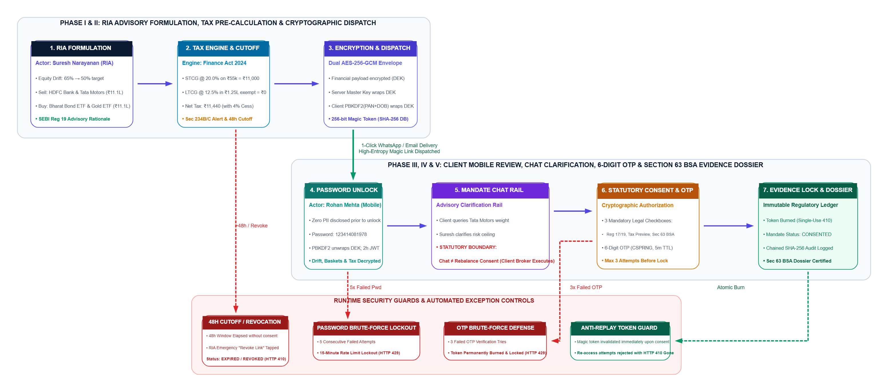

# FinConsent Multi-Agent Development Performance Report

**Report date:** 11 October 2026  
**Assessment period:** 6–11 October 2026  
**System assessed:** Antigravity multi-agent workflow with an orchestrator, Gemini models, Git-managed development runs  
**Evidence reviewed:** Uploaded repository ZIP, `.git` history, 24 run logs, run index, recorded test/build/browser verification results, and tracked project artifacts
**Assessment basis:** Evaluated the repository’s Git history, 24 Antigravity run logs, project artifacts, and recorded test/build/browser results across six parameters: prompt clarity, task decomposition, multi-agent orchestration, verification quality, rework and regressions, and scope/control management. Scores are qualitative, evidence-based estimates—not token-level measurements or controlled productivity benchmarks.

---

## 1. Executive Summary

The FinConsent repository records a concentrated, multi-agent product-development effort spanning initial repository construction, full-stack implementation, role-based workflows, security hardening, localization, UI redesign, browser-based verification, documentation, diagrams, and a 29-slide client presentation.

The evidence indicates that the workflow was effective at **turning detailed prompts into broad product output and then iterating against observed failures**. The user did not rely only on one-shot code generation: the run history includes acceptance criteria, specialized agent roles, automated tests, Puppeteer verification, review checkpoints, remediation runs, and Git commits.

The main limitation was **regression control across repeated generations and deployment verification**. The run history records repeated fixes for API and UI regressions, a production database connectivity problem that exposed an in-memory fallback, and presentation iterations in which previously correct Graphviz diagrams or screenshot choices were lost or incorrect. These are signs that the system could produce substantial output, but needed stronger automated safeguards to preserve earlier successes.

### Overall assessment

| Dimension | Assessment |
|---|---|
| Prompt engineering | **Strong** |
| Multi-agent task decomposition | **Strong** |
| Verification-oriented development | **Strong and progressively improving** |
| Iterative defect remediation | **Strong** |
| Cross-run regression prevention | **Needs improvement** |
| Production-readiness verification | **Improving; must be evidence-gated** |
| Overall qualitative score | **8.1/10** |

The score is a reasoned qualitative assessment of the available evidence. It is not an independently validated industry percentile, a measured productivity multiplier, or a statistical benchmark against other developers.

---

## 2. Evidence Inventory and Observed Counts

The following counts were derived from the supplied repository archive and Git history.

| Measure | Observed value | Interpretation |
|---|---:|---|
| Recorded run logs | 24 | 24 documented development runs are present in the repository |
| Git commits | 38 | The history contains checkpoints, implementation commits, fixes, and run closures |
| Tracked files at current revision | 342 | Current repository breadth; not equivalent to 342 newly authored files |
| Tracked paths changed between initial and current history | 342 | The repository evolved across the tracked project tree |
| Tracked Markdown files | 31 | Documentation and run-history footprint |
| Tracked PNG assets | 95 | Includes visual evidence and other image assets; not all are necessarily unique screenshots |
| Tracked PPTX files | 2 | Presentation artifacts |
| Tracked test/spec-named files | 19 | Filename-based count, not a guarantee that every file is an executable test |
| Latest completed product-test result recorded in runs | 223/223 tests | Recorded in the 10 October UI regression-fix run |
| Earlier comprehensive regression result | 200/200 tests | Recorded in the 9–10 October runs |
| Security browser scenarios | 8 in the 8 October hardening run; 11 in the 11 October compliance run | Agent-recorded Puppeteer scenario results |
| Latest presentation run status in `runs/INDEX.md` | In progress | The latest visual remediation was not marked completed in the supplied index |

**Counting caveats:** Commit count includes checkpoints and documentation/run-management commits, not only product changes. The file count measures repository scope, not code quality. Test totals belong to different runs and may overlap; they must not be added together. Browser scenarios are scenario counts, not a formal penetration-test certification.

---

## 3. Development Timeline

The run history shows a clear progression from construction to verification and refinement.

| Period | Main work recorded | What it demonstrates |
|---|---|---|
| 6 October | Initial FinConsent platform, API, live-data integration, role model, RBAC, request composer and end-to-end user journeys | Broad initial decomposition and rapid scaffold-to-product progression |
| 7 October | Journey UX, mandate error correction, WealthTech redesign, role-access overhaul, Puppeteer visual audit | Iterative refinement based on observed behavior and real-browser evidence |
| 8 October | Google sign-in cleanup, B2B RIA/client model, tenant isolation, security hardening, mandate password workflow | Increased attention to authorization boundaries and adversarial testing |
| 9 October | Eight-language localization, production localization audit, API regression repair, UI polish, documentation and presentation creation, Graphviz process flow | Expansion beyond application code into QA, localization, and client-facing deliverables |
| 10 October | Legal/tax/security website remediation, presentation regeneration, Render/MongoDB deployment hardening, UI regression fix | Correction of domain assumptions and production/runtime failure modes |
| 11 October | Production compliance audit and iterative visual remediation of the presentation | Evidence-driven follow-up; the latest presentation run remained in progress in the supplied run index |

This sequence is consistent with a development process that broadened scope and then increased the depth of verification. It also shows that some concerns—especially source-of-truth consistency, deployment persistence, and artifact regressions—were discovered later than ideal.

---

## 4. Prompt Engineering Effectiveness

Scores below are qualitative ratings based on the run records, task descriptions, acceptance criteria, observed fixes, and verification evidence.

| Capability | Score | Evidence-based rationale |
|---|---:|---|
| Requirements and specification | 9.0/10 | The runs use specifications, acceptance criteria, explicit workflow constraints, role definitions, and product boundaries |
| Task decomposition | 8.5/10 | Work is divided among architecture, backend, authentication, mandate features, data, UI, content, localization, QA, and review responsibilities |
| Verification-driven prompting | 8.5/10 | Runs call for unit tests, builds, API audits, Puppeteer scenarios, screenshots, and explicit pass/fail evidence |
| Iterative feedback quality | 9.0/10 | Later prompts refer to specific failures and demand precise corrections rather than generic polishing |
| Scope and instruction management | 7.0/10 | Boundaries became explicit, but the long carry-forward instruction sets increase the risk of conflicting or stale requirements |
| Regression prevention and source-of-truth control | 6.5/10 | Repeated diagram loss, screenshot mismatches, and runtime persistence issues show that safeguards did not always preserve prior successful output |

### What the scores mean

The strongest evidence of prompt-engineering skill is the shift from broad instructions to **testable acceptance criteria**. The user repeatedly specified actors, permitted actions, forbidden actions, expected status codes, UI states, screenshots, and validation steps. This reduces ambiguity and gives agents concrete definitions of completion.

The lower regression-control score reflects a different skill from writing a good prompt. Even a clear instruction can fail to protect a previously correct artifact if the build process reuses an older deck, a generator rewrites a diagram, or a test suite does not check the relevant visual state. Those protections need to be encoded into the workflow and its automated checks.

---

## 5. Multi-Agent Orchestration Assessment

### Effective patterns observed

1. **Specialized ownership:** Run plans identify distinct agent profiles for backend, authentication, mandates, tax, data, UI, content, localization, QA, and review.
2. **Wave-based execution:** The workflow records planning and execution in waves, allowing multiple workstreams to be coordinated.
3. **Review checkpoints:** Runs include acceptance criteria, reviewer/critic passes, revisions, and explicit closure statuses.
4. **Artifact-based verification:** Browser screenshots, test output, diagrams, and run logs are retained as evidence rather than relying solely on an agent's narrative.
5. **Git checkpoints:** The repository history records checkpoints and implementation/fix commits, supporting traceability and recovery.

### Constraints observed

- The presence of parallel agents does not by itself prove a speedup over one agent. No controlled, same-scope single-agent baseline is included in the supplied evidence.
- Commit count does not reveal the amount of human review or the compute cost of each agent.
- The repository shows that the orchestrator coordinates work, but it does not provide a complete quantitative breakdown of time spent waiting, integrating, retrying, or resolving conflicts.
- Several repeated fixes suggest that the workflow's quality gates did not consistently prevent regressions across run boundaries.

**Assessment:** The orchestration approach is well suited to a multi-domain product. The next improvement should focus on stable interfaces between agents, explicit file ownership, dependency-aware sequencing, and automated checks that protect already-approved behavior and artifacts.

---

## 6. Verification and Quality Evidence

The run logs record several levels of verification:

- Unit and integration test suites grew from early small suites to runs reporting 200+ passing tests, and a later UI remediation run reported 223/223 tests passing.
- Puppeteer was used for multi-role browser checks, responsive visual audits, mandate journeys, localization verification, and security scenarios.
- API audits and role/tenant isolation checks were recorded, including denial of cross-tenant access.
- Production builds and lint checks were run in multiple iterations.
- The 11 October compliance run recorded 11 successful Puppeteer security scenarios and 24 screenshots.
- Documentation consistency checks and Graphviz diagram generation were part of the later remediation work.

These records support the conclusion that verification became an important part of the development process.

They do **not** establish that the current deployed service is production-ready. In particular, a recorded test pass is not the same as independently rerunning the tests, and a successful container build is not proof of database persistence. The Render/MongoDB run history itself demonstrates why runtime readiness and durable writes need separate checks.

---

## 7. Rework and Regression Analysis

The most visible rework clusters are:

### 7.1 API and UI regression repair

The history includes a mandate `createdAt` type error, a dispatch-link issue, API regressions, and a blank-screen failure triggered by Reshare/Remind actions. These are normal classes of defects in rapid software development, but they show that integration regressions remained possible after earlier implementation passes.

**Process implication:** add targeted regression tests at the point of each fix, and ensure the full critical-path suite runs before a run can be closed as shipped.

### 7.2 Production persistence and readiness

The Render logs showed the server starting while MongoDB Atlas was unavailable and the application falling back to in-memory storage. Later work addressed connection diagnostics, readiness, write rollback, and safer seeding.

**Process implication:** production acceptance must explicitly require persistent storage, readiness tied to database health, safe failure on failed writes, and verification across restart. “Server live” or “build passed” must not be accepted as substitutes.

### 7.3 Presentation artifact regressions

The visual critique records previously correct Graphviz diagrams reverting to text-drawn versions, distorted screenshots, mismatched captions, and repeated screenshot states.

**Process implication:** the PPTX should be reproducibly generated from one canonical source, with diagram-source hashes or validation, slide metadata checks, aspect-ratio checks, and a rendered slide-by-slide review. A visual requirement is not reliably preserved until it is either checked automatically or verified in the final rendered deck.

### 7.4 Domain and claim corrections

Later remediation addressed legal references, tax assumptions, regulatory claims, security wording, and inconsistencies between implemented and planned capabilities.

**Process implication:** legal/tax/security content needs an explicit domain-review gate before being propagated into the website, documentation, diagrams, and presentation.

### Overall rework finding

The evidence supports the qualitative finding that **rework was material but productive**: later runs corrected earlier defects and strengthened the process. The available records do not contain enough consistent time or per-task usage data to calculate a defensible percentage of total effort spent on rework.

---

## 8. Comparative Interpretation

The repository does not contain controlled measurements of a solo developer or a single-agent implementation of the same product under the same constraints. Therefore, no defensible statement can be made that the multi-agent system was a specific multiple faster or more efficient.

A useful qualitative comparison is:

| Workflow | Expected strengths | Risks relative to the observed workflow |
|---|---|---|
| Conventional solo development | Strong continuity and direct control over decisions | More manual implementation and verification work for one person |
| Single AI coding agent | Simpler coordination and fewer inter-agent integration boundaries | Less natural specialization across security, UI, backend, QA, and documentation |
| FinConsent multi-agent workflow | Broad parallel specialization, explicit reviewer/QA roles, many artifacts and verification passes | Coordination overhead, duplicated work, cross-run regressions, and dependence on strong acceptance gates |

These are structural comparisons, not measured benchmark results. The observed evidence establishes that the multi-agent workflow covered a broad product lifecycle; it does not establish the counterfactual time or quota a different workflow would have required.

---

## 9. Quota and Cost Interpretation

For this report, Gemini quota is normalized to **zero direct monetary cost**, per the user's instruction. The user also reports having Gemini Pro access complementary through Jio.

This assumption is useful for evaluating workflow effectiveness without trying to estimate a monetary token cost. It does not mean that token consumption was zero, that the models had unlimited capacity, or that every model consumed the same quota for equivalent work.

The supplied repository and run logs do not provide a reliable, complete token ledger per model and run. Therefore:

- No exact token count is claimed.
- No cost-per-token or cost-per-feature figure is calculated.
- The report evaluates **output quality and workflow effectiveness**, not exact token efficiency.
- Quota percentage should not be treated as a universal token unit across models.

For future projects, record the starting/ending quota per model where available, model selection per run, run duration, retries, and task outcomes. That would allow a stronger normalized productivity comparison over multiple projects.

---

## 10. Recommendations for the Next Development Cycle

### Priority 1 — Encode acceptance criteria as release gates

Require a run to pass relevant tests, build, API checks, security invariants, and critical-path end-to-end checks before it can be marked shipped. Distinguish code-complete, tests-passing, deployment-verified, and production-ready states.

### Priority 2 — Protect prior successes against regression

Maintain a small mandatory suite for core user journeys, tenant isolation, consent state transitions, persistent storage, and generated presentation artifacts. Add a regression test whenever a bug is fixed.

### Priority 3 — Establish one source of truth for generated artifacts

For diagrams and presentations, use canonical source files and deterministic generators. Validate that the final output contains the current generated diagrams, correct screenshots, correct slide dimensions, and no clipping or distorted images.

### Priority 4 — Narrow agent ownership and interfaces

Assign clear file ownership and expected outputs to each agent. Make agents report interface changes, assumptions, unresolved dependencies, and tests run. Use a reviewer to check integration contracts rather than merely summarizing individual agent successes.

### Priority 5 — Require evidence, not self-reported completion

Every PASS should identify the exact command or browser scenario, its result, and the artifact/log proving it. Mark checks as UNVERIFIED if the environment did not allow them to run.

### Priority 6 — Track three productivity indicators across projects

1. **First-pass acceptance rate:** percentage of tasks accepted without a corrective follow-up run.
2. **Regression rate:** number of previously passing behaviors or artifacts broken by later changes.
3. **Verified deliverables per development cycle:** features and artifacts that pass the defined quality gate.

These are more useful indicators of prompt-engineering improvement than raw lines of code or number of commits.

---

## 11. Final Assessment

The evidence supports the conclusion that the FinConsent workflow achieved broad end-to-end development coverage in a short period, using specialized agents, an orchestrator, Git-tracked runs, automated testing, browser verification, and iterative remediation.

The most defensible characterization is:

- **Prompt engineering:** strong, particularly in specification, decomposition, constraints, and evidence-driven iteration.
- **Multi-agent orchestration:** effective for broad parallel work, with integration and regression control as the primary improvement area.
- **Verification discipline:** substantial and increasingly rigorous, although recorded checks should not be confused with independent confirmation of the current deployed state.
- **Rework control:** the main opportunity for improvement.
- **Overall qualitative assessment:** **8.1/10**, based on the documented evidence and the scoring framework in this report.

This score is an analytical judgment, not a statistically benchmarked rank. The available evidence is sufficient to assess the structure and maturity of the workflow, but not to claim an exact productivity multiplier or a measured token-efficiency rate.

The recommended next step is to preserve the current multi-agent approach while strengthening release gates, regression protection, artifact reproducibility, and evidence-based closure criteria. These changes are likely to improve the share of generated work that survives verification on the first pass.

---

## Appendix A — Evidence Sources

- Uploaded `New folder.zip`, including `.git` history and project files.
- `runs/INDEX.md`.
- Run logs from 6–11 October 2026, including initial build, RBAC/API, UI redesign, Puppeteer visual audit, security hardening, localization, API regression remediation, documentation/presentation generation, website legal/tax/security remediation, Render/MongoDB hardening, and presentation visual remediation.
- Git commit subjects and repository tree counts.
- Test, lint, build, API audit, Puppeteer, screenshot, and documentation-consistency results recorded in the run logs.

## Appendix B — Interpretation Rules

- A recorded run result is attributed to the run log; it is not represented as independently reproduced in this report.
- Counts from different test runs are not summed because suites overlap.
- Git commits and tracked files are treated as activity/scope indicators, not direct measures of quality or effort.
- Qualitative scores are explicitly labeled as judgment, not external benchmarks.
- No exact token usage, monetary token cost, or single-agent speedup is inferred from quota percentage alone.

---

# FinConsent

**Institutional Advisory Proposal Consent, Capital Gains Tax Transparency & Tamper-Evident Record-Keeping Infrastructure for SEBI-Registered Investment Advisers (RIAs)**

[-brightgreen)](#testing--security-validation-evidence)
[](#testing--security-validation-evidence)
[](#sebi-regulatory-and-legal-compliance)
[](#sebi-regulatory-and-legal-compliance)
[](#security--cryptographic-architecture)
[-orange)](#deployment--hosting-architecture)

---

## Executive Overview

**FinConsent** is an institutional B2B WealthTech platform engineered specifically for Indian SEBI-Registered Investment Advisers (RIAs), compliance officers, and advisory clients. Built to support **Regulations 19 and 22 of the SEBI (Investment Advisers) Regulations, 2013**, FinConsent provides an auditable, verifiable digital rail for non-discretionary investment advisory workflows.

In India's fee-only advisory framework, non-discretionary investment advisers provide advice, asset allocation models, and investment rationale, but do not execute securities transactions on exchange order books (Regulations 22 & 22B). Order placement is conducted independently by the client or via non-discretionary implementation services without advice-fee blending. Under Regulation 19, advisers must maintain a contemporaneous record of advice tendered, investment rationale, and client acknowledgements for at least **5 years (1,825 days)**. Traditionally, advisers and clients coordinate rebalancing recommendations across informal channels (WhatsApp chats, email threads, SMS, or phone calls). While legally discoverable, these unstructured records fragment rationale, lack pre-trade tax calculations, and create severe administrative collation overhead during SEBI/BASL compliance audits. Furthermore, following statutory capital gains tax adjustments (Finance Act 2024: STCG 20%, LTCG 12.5% beyond ₹1.25L exemption), rebalancing recommendations without pre-trade tax impact visibility can result in unexpected tax liabilities for clients.

FinConsent addresses these operational friction points by pairing an automated **Capital Gains Decision-Support Tax Engine** with an **authenticated AES-256-GCM dual-envelope encrypted mandate lifecycle**, a scoped in-app mandate clarification chat rail, convenience password protection, verification OTP confirmation (an evidentiary safeguard under Section 63 BSA), and an append-only **SHA-256 forward-hash chained audit ledger** designed to support electronic record requirements under **Section 63 of the Bharatiya Sakshya Adhiniyam, 2023 (BSA)** and **Section 65B of the Indian Evidence Act, 1872**.

---

## Advisory Governance & Regulatory Framework

```
┌────────────────────────────────────────────────────────────────────────────────────────┐
─────────────────── ADVISORY PRACTICE RISK & MITIGATION MAPPING ─────────────────────────
├─────────────────────────────────────────┬──────────────────────────────────────────────┤
│ Legacy Informal Practice (Hypotheses)   │ FinConsent Governance Solution               │
├─────────────────────────────────────────┼──────────────────────────────────────────────┤
│ • Informal communication over WhatsApp   │ • Standardized mandate workflow aligned with │
│   or email fragments rationale.         │   SEBI Regulation 19 record-keeping rules.   │
│ • No pre-trade tax visibility; clients  │ • Pre-computed statutory capital gains       │
│   surprised by advance tax liabilities. │   transparency (STCG 20%, LTCG 12.5%).       │
│ • Dispersed documentation across PDFs,  │ • Centralized, tamper-evident audit ledger   │
│   spreadsheets, and email threads.      │   inspectable for 5 statutory years.         │
│ • Ambiguity regarding client approval   │ • Scoped mandate clarification chat clearly  │
│   prior to order placement.             │   distinguished from explicit consent.       │
└─────────────────────────────────────────┴──────────────────────────────────────────────┘
```

### Statutory Regulatory Pillars:
1. **SEBI (Investment Advisers) Regulations, 2013 — Regulations 19, 22 & 22B:** Mandates that every non-discretionary RIA maintain comprehensive, time-stamped client records, advice rationale, master client agreements (Regulation 13), and proposal acknowledgement records for a statutory minimum period of **5 years (1,825 days)**. Trade execution remains strictly non-discretionary.
2. **Bharatiya Sakshya Adhiniyam, 2023 (BSA) — Section 63 / Indian Evidence Act — Section 65B:** Governs the admissibility of electronic records in judicial and regulatory proceedings. FinConsent records capture client device IP, User-Agent, synchronized IST timestamps, and cryptographic hash verification to support electronic record integrity.
3. **Current Capital Gains Tax Regime (Finance Act 2024):** Computes estimated tax impact under statutory rates: Short-Term Capital Gains (STCG) at **20.0%** (Section 111A) and Long-Term Capital Gains (LTCG) at **12.5%** above the annual statutory aggregate ₹1,25,000 exemption (Section 112A), plus 4% Health & Education Cess. High-income surcharges (up to 15% on equity capital gains) and carried-forward losses are disclaimed as individual tax variables.
4. **Income-tax Act, 1961 — Advance Tax Planning:** When net annual tax liability is ₹10,000 or more, advance tax provisions apply (Section 208). Under the First Proviso to Section 234C(1), interest for shortfall in advance tax is not charged if the shortfall is due to capital gains, provided remaining tax is deposited in subsequent installments or before March 31.
5. **Digital Personal Data Protection Act, 2023 (DPDP Act):** Protects investor personal data with purpose limitation and strict access controls. Section 8(7) accommodates mandatory statutory retention periods, ensuring compliance audit trails are lawfully maintained throughout the SEBI 5-year window.

---

## Core Personas & Role Taxonomy

FinConsent supports five distinct system roles, each bounded by strict Role-Based Access Control (RBAC) and multi-tenant isolation:

```
┌────────────────────────────────────────────────────────────────────────────────────────┐
│                              SYSTEM ACTOR & ROLE MATRIX                                │
├─────────────────────┬──────────────────────┬──────────────────────┬────────────────────┤
│ Role ID             │ Illustrative Persona │ Primary Interface    │ Key Responsibilities│
├─────────────────────┼──────────────────────┼──────────────────────┼────────────────────┤
│ sebi-ria            │ Suresh Narayanan     │ Desktop Advisory Hub │ • Portfolio drift  │
│                     │ Prudent Wealth       │ `/dashboard`         │   formulation      │
│                     │ INA000088921         │ `/mandates/new`      │ • Tax engine calc  │
│                     │ ria@example.in       │ `/clients`           │ • Mandate dispatch │
│                     │                      │                      │ • Clarification chat│
├─────────────────────┼──────────────────────┼──────────────────────┼────────────────────┤
│ hni-client          │ Rohan Mehta          │ Mobile Review Portal │ • Direct link      │
│                     │ Client # cli_1       │ `/m/:token`          │ • PAN+DOB password │
│                     │ client@example.in    │ `/m/:token/verify`   │ • Proposal review  │
│                     │ PAN: XXXXX1234F      │ `/m/:token/receipt`  │ • Mandate chat     │
│                     │ DOB: 14/08/1978      │ Authenticated Portal │ • OTP authorization│
├─────────────────────┼──────────────────────┼──────────────────────┼────────────────────┤
│ compliance_officer  │ Vikramaditya Roy     │ Compliance Hub       │ • Pre-trade review │
│                     │ Sentinel Compliance  │ `/requests`          │ • Reg 19 scrutiny  │
│                     │ compliance@example.in│ `/mandates/:id`      │ • Hash chain audit │
│                     │                      │ Modal Dossier        │ • BSA Sec 63 cert  │
├─────────────────────┼──────────────────────┼──────────────────────┼────────────────────┤
│ admin               │ Neha Singhania       │ Operations Command   │ • Platform health  │
│                     │ Platform Admin       │ `/dashboard`         │ • Tenant oversight │
│                     │ admin@example.in     │ User Administration  │ • Quota governance │
│                     │                      │ System Audits        │ • Disaster recovery│
├─────────────────────┼──────────────────────┼──────────────────────┼────────────────────┤
│ guest               │ Public Evaluator     │ Public Showcase      │ • DPDP disclosures │
│                     │ Anonymous Visitor    │ `/`                  │ • Interactive demo │
│                     │                      │ `/legal/*`           │ • Practice signup  │
└─────────────────────┴──────────────────────┴──────────────────────┴────────────────────┘
```

---

## Core Workflow & Mandate Lifecycle

The FinConsent non-discretionary trade consent workflow executes across deterministic advisory phases, safeguarded by statutory timeouts and cryptographic audit records:


*Figure: FinConsent End-to-End Statutory Advisory Process Flow (SEBI Reg 19, SHA-256 Ledger & Section 63 BSA Audit Trail)*

```
┌──────────────────────────────────────────────────────────────────────────────────────────────────┐
│                                 END-TO-END WORKFLOW SEQUENCE                                     │
└──────────────────────────────────────────────────────────────────────────────────────────────────┘

   [ 1. FORMULATION ]  RIA drafts portfolio rebalance (Equities -> Debt & Gold ETF)
            │
            ▼
   [ 2. TAX ESTIMATE]  Real-time Tax Engine computes STCG (20%) & LTCG (12.5% + 4% cess)
            │
            ▼
   [ 3. SECURE DISPATCH] Dual-envelope encryption generates 256-bit magic token with 48h cutoff
            │
            ▼
   [ 4. CLIENT DELIVERY] Delivered via Email (WhatsApp roadmap); token stored as SHA-256 hash
            │
            ▼
   [ 5. PASSWORD UNLOCK] Client enters verification password: PAN Last 4 + DOB (DDMMYYYY)
            │
            ▼
   [ 6. ADVISORY CHAT  ] Client asks clarification; adviser replies in-app (Chat != Consent)
            │
            ▼
   [ 7. EXPLICIT CONSENT] Client checks statutory declarations; requests 6-digit verification OTP
            │
            ▼
   [ 8. OTP VERIFICATION] Distributed rate limiter validates OTP; burns token atomically
            │
            ▼
   [ 9. LOCKED EVIDENCE] Mandate locked; Section 63 BSA (Sec 65B antecedent) Certificate generated
```

### Mandate State Machine

FinConsent implements a deterministic 6-state lifecycle:

```
              ┌────────────────────────────────────────────────────────┐
              │                                                        │
              ▼                                                        │
         ┌─────────┐            RIA Dispatches Link       ┌──────────┐ │
         │  DRAFT  │ ───────────────────────────────────> │   SENT   │ │
         └─────────┘                                      └──────────┘ │
              │                                                │       │
              │                                                │ Client Inputs
              │                                                │ PAN + DOB Password
              │                                                ▼       │
              │                                           ┌──────────┐ │
              │                                           │  VIEWED  │ │
              │                                           └──────────┘ │
              │                                                │       │
              │                                                │ 1. Accept Declarations
              │ 48-Hour Cutoff                                 │ 2. Verify 6-Digit OTP
              │ Elapsed                                        ▼       │
              │                                           ┌───────────┐│
              ├─────────────────────────────────────────> │ CONSENTED ││
              │                                           └───────────┘│
              │                                                        │
              │ Advisory Revocation / Market Drift                     │
              ▼                                                        │
         ┌─────────┐                                                   │
         │ REVOKED │ <─────────────────────────────────────────────────┘
         └─────────┘
              ▲
              │ Cutoff Elapsed Prior to Consent
         ┌─────────┐
         │ EXPIRED │
         └─────────┘
```

---

## Security & Cryptographic Architecture

FinConsent implements defense-in-depth controls to safeguard client portfolios, PAN identifiers, and compliance records:

```
┌────────────────────────────────────────────────────────────────────────────────────────┐
│                        DUAL-ENVELOPE ENCRYPTION ARCHITECTURE                           │
├────────────────────────────────────────────────────────────────────────────────────────┤
│                                                                                        │
│   SENSITIVE FINANCIAL PAYLOAD                                                          │
│   (Trade quantities, ISINs, sale values, tax calculations, rebalancing rationale)     │
│                              │                                                         │
│                              ▼  Encrypted with 256-bit random Data Encryption Key (DEK)│
│                     ┌──────────────────┐                                               │
│                     │   AES-256-GCM    │                                               │
│                     │ (Auth Tag 16-byte│                                               │
│                     └────────┬─────────┘                                               │
│                              │                                                         │
│         ┌────────────────────┴────────────────────┐                                    │
│         ▼                                         ▼                                    │
│   SERVER WRAPPING (RIA Access)              CLIENT WRAPPING (Investor Access)          │
│   Wrapped with Server Master Key            Wrapped with Derived Client Key            │
│   via AES-256-GCM envelope                  via PBKDF2 (100,000 iterations default)    │
│   (SERVER_MASTER_KEY configuration)         Key: PBKDF2(PAN_last_4 + DOB, salt)        │
│                                                                                        │
│   * Result: Neither plaintext DEK nor client password is ever persisted in database.   │
└────────────────────────────────────────────────────────────────────────────────────────┘
```

### 1. Mandate Password Access & Entropy Model
- Direct magic links (`/m/:token`) provide access to minimal public metadata (firm name, advisor name, and client name).
- Trade quantities, ISIN codes, transaction values, and rationale remain encrypted until unlocked by the client.
- The unlock password uses client KYC attributes: `Last 4 characters of PAN` + `Date of Birth in DDMMYYYY` (e.g., `123414081978`).
- **Security Guidance & Entropy Model:** PAN-last-4 + DOB functions as a convenience verification PIN rather than a high-entropy secret. It is defended online against brute-force enumeration by strict sliding-window rate limiters, lockout thresholds, and offline by salted PBKDF2 key derivation (100,000 iterations in production).
- Upon successful verification, the server issues a scoped, short-lived unlock JWT (`x-unlock-token`) valid for **2 hours**.

### 2. Magic Link Token Security & Single-Use Hashing
- Magic tokens are generated using a CSPRNG: `crypto.randomBytes(32).toString('hex')` (256 bits of entropy).
- **Hashed at Rest:** Raw tokens are never stored in the database; they are one-way hashed with SHA-256 (`magicTokenHash`) prior to MongoDB persistence.
- **Single-Use Invalidation:** Upon successful OTP consent, the token is burned. Re-accessing the link returns `410 Gone / 404 Not Found`.

### 3. Verification OTP Delivery & Rate Limiting
- **6-Digit Dynamic OTP:** Valid for 5 minutes.
- **Channel Delivery:** Delivered via registered email and secure in-app display (SMS disabled by policy; WhatsApp delivery on roadmap).
- **Brute-Force Counter:** Maximum of **3 failed attempts**. Upon the 3rd consecutive failed entry, access is locked, logging an `OTP_LOCKOUT` audit event.

### 4. Tenant Isolation & RBAC Boundaries
- Every API endpoint enforces strict multi-tenant scoping: an RIA can only query clients and mandates belonging to their verified firm ID (`req.user.firmName` / `req.user.id`).
- Attempted cross-tenant queries return `HTTP 403 Forbidden`.
- Client role accounts attempting advisor actions are blocked at both client routing and server middleware.

### 5. Multi-Factor Authentication (MFA)
- Advisory and compliance accounts support RFC 6238 TOTP Two-Factor Authentication.
- Staff credentials return `mfaRequired: true`, requiring TOTP completion before accessing protected endpoints.

---

## Tamper-Evident Audit Trail & Electronic Evidence

FinConsent maintains an append-only cryptographic ledger where lifecycle events are recorded with SHA-256 forward-hash chaining:

```
┌────────────────────────────────────────────────────────────────────────────────────────┐
│                        APPEND-ONLY SHA-256 HASH CHAINING                               │
├────────────────────────────────────────────────────────────────────────────────────────┤
│                                                                                        │
│   AUDIT RECORD N-1                      AUDIT RECORD N                                 │
│   ┌───────────────────────────────┐     ┌───────────────────────────────┐              │
│   │ event: MANDATE_DISPATCHED     │     │ event: PASSWORD_UNLOCKED      │              │
│   │ timestamp: 2026-10-08T10:15   │     │ timestamp: 2026-10-08T10:22   │              │
│   │ ipAddress: 198.51.100.14      │     │ ipAddress: 203.0.113.12       │              │
│   │ payloadHash: c4b8f0...        │────►│ prevHash:    c4b8f0...        │              │
│   │ prevHash:    a10e82...        │     │ payloadHash: e92a71...        │              │
│   └───────────────────────────────┘     └──────────────┬────────────────┘              │
│                                                        │                               │
│                                                        ▼                               │
│                                         AUDIT RECORD N+1 (CONSENTED)                   │
│                                         ┌───────────────────────────────┐              │
│                                         │ event: CONSENT_GRANTED        │              │
│                                         │ timestamp: 2026-10-08T10:28   │              │
│                                         │ prevHash:    e92a71...        │              │
│                                         │ payloadHash: 7f3d99...        │              │
│                                         └───────────────────────────────┘              │
└────────────────────────────────────────────────────────────────────────────────────────┘
```

### Auditable Event Catalog
- `MANDATE_CREATED`: Portfolio parameters, target allocation, and rationale drafted.
- `MANDATE_DISPATCHED`: 256-bit magic link generated; 48-hour cutoff timer initiated.
- `MANDATE_OPENED`: Client accesses the link; device IP and User-Agent recorded.
- `PASSWORD_UNLOCKED`: Client successfully authenticates with PAN+DOB password.
- `PASSWORD_FAILED`: Incorrect password entered; failed attempt counter incremented.
- `CHAT_MESSAGE_SENT`: Advisory clarification message posted by client or advisor.
- `OTP_GENERATED`: 6-digit statutory verification OTP dispatched.
- `OTP_LOCKOUT`: Verification attempt threshold breached (3 failures); access locked.
- `CONSENT_GRANTED`: Statutory declarations accepted and OTP verified; mandate sealed.
- `MANDATE_REVOKED`: Advisor revokes active proposal due to market conditions or allocation updates.

### Section 63 BSA / Section 65B Compliance Certificate
Upon consent, the platform compiles an official electronic certificate containing:
- Unique Verification Receipt ID (`REC-MAN-XXXX-YYYY`)
- Client Legal Name & Masked PAN (`XXXXX1234F`)
- RIA SEBI Registration Number (`INA000088921`) & Firm Details
- Execution Timestamp (Indian Standard Time - IST)
- Electronic Channel Verification (`OTP_IN_APP_EMAIL`)
- Pre-Computed Capital Gains & Tax Liabilities
- Overall SHA-256 Ledger Hash Seal

---

## Scoped Mandate Chat vs. Statutory Consent

FinConsent includes a mandate-specific discussion rail allowing clients and advisers to clarify recommendations before granting consent:

```
┌────────────────────────────────────────────────────────────────────────────────────────┐
│                      MANDATE CHAT VS. STATUTORY CONSENT BOUNDARY                       │
├─────────────────────────────────────────┬──────────────────────────────────────────────┤
│ Scoped Mandate Chat                     │ Documented Advisory Consent (OTP)            │
├─────────────────────────────────────────┼──────────────────────────────────────────────┤
│ • Clarifies execution rationale, asset  │ • Explicit client consent record maintained  │
│   weights, or capital gains questions.  │   under SEBI Regulation 19.                  │
│ • Requires password-unlocked session.   │ • Requires affirmative declaration checks.   │
│ • Preserved in audit trail history.     │ • Requires 6-digit OTP verification.         │
│ • ⚠️ DOES NOT CONSTITUTE TRADE CONSENT. │ • Formally commits immutable Section 63 BSA  │
│   Cannot authorize rebalancing trades.  │   Compliance Receipt and locks mandate.      │
└─────────────────────────────────────────┴──────────────────────────────────────────────┘
```

---

## Capital Gains Tax Engine (Current Statutory Provisions)

The built-in tax engine calculates tax liabilities dynamically across trade baskets:

| Capital Gain Category | Statutory Rate | Exemption Threshold | Applicable Legal Section |
|---|---|---|---|
| **Short-Term Capital Gains (STCG)** | **20.0%** | None | Section 111A, Income-tax Act, 1961 |
| **Long-Term Capital Gains (LTCG)** | **12.5%** | **₹1,25,000** annual aggregate | Section 112A, Income-tax Act, 1961 |
| **Health & Education Cess** | **4.0%** | Applicable on base tax | Finance Act |

> **Assumptions & Disclaimers:**
> - The ₹1,25,000 LTCG exemption is applied assuming availability across the client's aggregate annual capital gains (not per individual security or transaction).
> - High-income surcharges (up to 15% on equity capital gains) and carried-forward capital losses are excluded from estimates.
> - Calculations are provided for advisory decision support and do not constitute formal tax assessments.

### Quarterly Advance Tax Calendar
When estimated annual tax liability reaches or exceeds **₹10,000**, the portal displays an Advance Tax Planning notice:
- **1st Installment (15%):** On or before **15th June**
- **2nd Installment (45%):** On or before **15th September**
- **3rd Installment (75%):** On or before **15th December**
- **4th Installment (100%):** On or before **15th March**

*(Note: Under the proviso to Section 234C(1), interest for shortfall in advance tax is not charged if the shortfall is due to capital gains, provided remaining tax is deposited in subsequent installments.)*

---

## Localization & Multilingual Architecture

FinConsent provides native localization across **8 supported languages**:

- **Supported Locales:** English (`en`), Hindi (`hi`), Tamil (`ta`), Bengali (`bn`), Gujarati (`gu`), German (`de`), Japanese (`ja`), Korean (`ko`).
- **Standard Financial Numbering:** Monetary figures (₹), quantities, percentages, and ISIN codes use standard ASCII English numerals across all locales for dispute-resolution consistency.
- **Language Switcher:** Accessible in the application header and user profile settings.

---

## Client-Facing API Architecture

```
┌────────────────────────────────────────────────────────────────────────────────────────┐
│                            API ROUTE & AUTHORIZATION MATRIX                            │
├─────────────────────────┬─────────┬───────────────────┬────────────────────────────────┤
│ Endpoint                │ Method  │ Authorization     │ Description                    │
├─────────────────────────┼─────────┼───────────────────┼────────────────────────────────┤
│ `/api/auth/login`       │ POST    │ Public / Anon     │ Authenticate with credentials   │
│ `/api/auth/mfa/verify`  │ POST    │ Temp Auth Token   │ Verify RFC 6238 TOTP challenge │
│ `/api/mandates`         │ GET     │ Bearer JWT (RIA)  │ List tenant-scoped mandates    │
│ `/api/mandates`         │ POST    │ Bearer JWT (RIA)  │ Create rebalance recommendation│
│ `/api/mandates/:id`     │ GET     │ Bearer JWT (RIA)  │ Get decrypted mandate details  │
│ `/api/mandates/:id/disp`│ POST    │ Bearer JWT (RIA)  │ Dispatch mandate magic link    │
│ `/api/mandates/:id/rev` │ POST    │ Bearer JWT (RIA)  │ Revoke active mandate link     │
│ `/api/clients`          │ GET/POST│ Bearer JWT (RIA)  │ Manage advisory client roster  │
│ `/api/public/mandates/:t`│ GET    │ Bearer Token / PW │ Public review / metadata view  │
│ `/api/public/.../unlock`│ POST    │ Public / PW       │ Verify PAN+DOB; issue unlockTok│
│ `/api/public/.../chat`  │ GET/POST│ Unlock Token      │ Mandate clarification chat     │
│ `/api/public/.../req-otp`│ POST   │ Unlock Token      │ Request 6-digit consent OTP    │
│ `/api/public/.../ver-otp`│ POST   │ Unlock Token      │ Verify OTP & commit consent    │
│ `/api/requests`         │ GET/POST│ Bearer JWT        │ Advisory & compliance hub      │
│ `/api/billing/*`        │ ALL     │ Bearer JWT (RIA)  │ Institutional billing tiers    │
│ `/api/health`           │ GET     │ Public            │ System & DB health checks      │
└─────────────────────────┴─────────┴───────────────────┴────────────────────────────────┘
```

---

## Deployment & Hosting Architecture

- **Data Sovereignty:** In alignment with SEBI's Cybersecurity and Cyber Resilience Framework (CSCRF) and Cloud Security Guidelines, all databases, audit logs, cryptographic hashes, and server infrastructure reside in **AWS Asia Pacific (Mumbai) region (`ap-south-1`)**.
- **Frontend Container:** Vite 6 React single-page application compiled to static production chunks served over HTTPS.
- **Backend Container:** Node.js Express service running behind TLS termination reverse proxy with Helmet HSTS enforcement (`maxAge: 31536000`).
- **Key Isolation:** Envelope Server Master Key (`SERVER_MASTER_KEY`) is isolated from application authentication secrets (`JWT_SECRET`).
- **Storage Layer:** MongoDB Atlas with point-in-time recovery and in-memory/shared synchronization for distributed rate limiting.

---

## Testing & Validation Evidence

All platform invariants and security controls have been validated in automated test suites:

- **Vitest Automated Test Suites:** **17 / 17 test suites passing (230 / 230 tests passing, 100%)**:
  1. `taxCalculator.test.js` (8 tests) — STCG 20%, LTCG 12.5%, Cess, Advance Tax.
  2. `api.test.js` (2 tests) — Health checks & JWT auth guards.
  3. `roles_guest_workflow.test.js` (6 tests) — Guest navigation & role switcher.
  4. `security_audit_remediation.test.js` (26 tests) — SHA-256 token hashing, HSTS, MFA, rate limits.
  5. `acceptance.test.js` (4 tests) — Magic link generation, 48h expiry, instant revocation.
  6. `rbac_requests_sms.test.js` (6 tests) — SMS deprecation policy & RBAC request permissions.
  7. `role_experience_and_access_control.test.js` (16 tests) — Role boundaries & views.
  8. `security_hardening.test.js` (15 tests) — Tenant isolation, IDOR barriers, OTP lockout.
  9. `mandate_createdat_date.test.js` (1 test) — Date serialization integrity.
  10. `b2b_ria_client_hierarchy.test.js` (12 tests) — B2B organizational hierarchy.
  11. `dispatch_print_testing.test.js` (4 tests) — Dispatch password & testing unlock rail.
  12. `localization_i18n_l10n.test.js` (15 tests) — 8-language localization & ASCII numbers.
  13. `crypto_regression_and_normalization.test.js` (18 tests) — Cryptographic key derivation and AES-256-GCM.
  14. `i18n_automated_checks.test.js` (45 tests) — Translation key parity across all domains.
  15. `mandate_security_and_chat.test.js` (20 tests) — Scoped chat and envelope encryption.
  16. `production_deployment_and_readiness.test.js` (14 tests) — Container port/host binding (0.0.0.0), URI parsing & alias resolution (`MONGODB_URI`, `MONGO_URI`, `DATABASE_URL`), secret sanitization in logs, readiness probe (`/api/ready`, `/api/health`) 503 gating under database disconnection, write protection middleware, and strict production in-memory fallback prevention.
  17. `api_regressions_and_contract_audit.test.js` (15 tests) — Zero-error API contracts, error boundaries, quick action hooks, and token preservation.

---

## Production Deployment Guide (Render & MongoDB Atlas)

### 1. Server Port & Network Interface Binding
- **Port Resolution:** The Express server dynamically reads `process.env.PORT` injected by container platforms (e.g., Render sets `PORT=10000`). If `PORT` is unset, it defaults to `5000`.
- **Container Interface (0.0.0.0):** In containerized environments (Docker / Render Linux containers), the server explicitly binds to `HOST = process.env.HOST || '0.0.0.0'`. This allows the platform's ingress reverse proxy (ALB / Nginx / Envoy) to route traffic to the container.
- **Why `localhost:5000` appears in logs:**
  - The log line `FinConsent Server listening on http://localhost:5000` is an informational developer convenience string printed for local browser testing. It is **not** a deployment bug and does not restrict container networking.
  - The server binds to `0.0.0.0:${PORT}` across all interfaces while logging both the container host binding and the local preview URL.

### 2. MongoDB Atlas Configuration
1. **Network Access (IP Whitelist):**
   - In the MongoDB Atlas Dashboard, navigate to **Security** -> **Network Access**.
   - Add IP address `0.0.0.0/0` ("Allow Access from Anywhere").
   - *Why:* Render Web Services (Free and Standard tiers) use dynamic outbound IP addresses across AWS and GCP infrastructure. Without `0.0.0.0/0`, outgoing connections from Render timeout with `MongooseServerSelectionError: connect ETIMEDOUT`.
2. **Database User Credentials & Password URL-Encoding:**
   - In **Security** -> **Database Access**, create a user with `readWrite` permissions on database `finconsent`.
   - **RFC 3986 URL Encoding:** If the database password contains special characters (e.g. `@`, `:`, `/`, `?`, `#`, `[`, `]`, `%`, `&`, `+`), they **must** be percent-encoded (`encodeURIComponent`) before inclusion in the connection URI (e.g. `@` -> `%40`, `#` -> `%23`).
   - Remove any `<password>` angle brackets from the Atlas template snippet.
3. **Connection String Format:**
   - Standard SRV format: `mongodb+srv://<username>:<url_encoded_password>@<cluster-host>/finconsent?retryWrites=true&w=majority`
   - Explicitly specify `/finconsent` to avoid defaulting to the `test` database.

### 3. Render Web Service Settings
1. **Build & Start Commands:**
   - **Build Command:** `npm install && npm run build`
   - **Start Command:** `node server/index.js` (or `npm start`)
2. **Environment Variables:**
   - `NODE_ENV`: `production`
   - `PORT`: (Managed automatically by Render; injects `10000`)
   - `MONGODB_URI`: `mongodb+srv://<username>:<url_encoded_password>@<cluster-host>/finconsent?retryWrites=true&w=majority` *(Supported aliases: `MONGO_URI`, `DATABASE_URL`). Do not wrap in quotes.*
   - `JWT_SECRET`: 64+ char random string
   - `SERVER_MASTER_KEY`: 64+ char random string
   - `ALLOW_IN_MEMORY_FALLBACK`: Leave unset or set to `false` in production.
3. **Health Check Path:**
   - Set to `/api/ready` (or `/api/health`).
   - If MongoDB Atlas is connected, returns HTTP `200 OK` and traffic is routed.
   - If MongoDB Atlas is disconnected, returns HTTP `503 Service Unavailable`, preventing unpersisted traffic from being routed to the instance.

### 4. Zero Silent Fallback & Data Write Gating
- In production (`NODE_ENV === 'production'`), FinConsent **never** silently falls back to in-memory storage if MongoDB Atlas is disconnected.
- If the persistent database is unavailable:
  - Readiness probes (`/api/ready` and `/api/health`) return HTTP `503 Service Unavailable`.
  - All mutating data-dependent operations (`POST /api/mandates`, `POST /api/clients`, `POST /api/public/consent`, `POST /api/requests`, `POST /api/auth/register`, and direct store mutations) are intercepted and rejected with HTTP `503 DATABASE_UNAVAILABLE`.
  - In-memory storage is permitted only in explicitly configured development or test environments (`NODE_ENV !== 'production'`) or when `ALLOW_IN_MEMORY_FALLBACK=true` is explicitly passed.

### 5. Automated Verification & Test Suite
FinConsent maintains a rigorous automated testing suite covering cryptographic operations, role-based access control, tenant isolation, emergency revocation, production readiness, and UI action stability:
- **Test Framework:** Vitest v3.2.7 with jsdom environment
- **Coverage:** 17 test suites, 230 automated tests (100% passing, 0 regressions)
- **UI Action & Modal Hook Safety:** Dedicated verification for quick actions ("Reshare most urgent links", "Remind Client", "Share Link"), ensuring unconditional React hook execution order, safe optional chaining, resilient clipboard copy fallbacks, and global `<ErrorBoundary>` protection preventing blank screens.
- **Run Tests:** `npm test`
- **Lint Code:** `npm run lint`
- **Production Build:** `npm run build`

---

## Competitor Landscape & Adjacent Product Positioning

FinConsent operates within the Indian wealth technology ecosystem, serving fee-only non-discretionary investment advisers. It is structurally differentiated from adjacent execution and e-signature tools:

| Dimension | smallcase Publisher / Gateway | Broker Basket Orders (e.g. Zerodha) | DocuSign / Adobe Sign | FinConsent Architecture |
|---|---|---|---|---|
| **Target User** | Research Analysts & Model Portfolio Managers | Self-directed retail investors & active traders | General corporate enterprises | Fee-only Registered Investment Advisers (RIAs) |
| **Primary Goal** | Distribute standardized baskets and execute trades via broker APIs. | Fast multi-leg exchange order execution. | Generic contract e-signature. | Rebalancing proposal review, rupee tax estimates, and audit-ready acknowledgements. |
| **Exchange Order Execution** | **Yes:** Routes orders to connected broker accounts via Gateway API. | **Yes:** Direct order placement on exchange order book. | **No:** Document signing only. | **No:** Platform halts at proposal acknowledgement. Zero broker order routing. |
| **Pre-Trade Tax Preview** | **No:** Asset weights and CAGR returns; no rupee capital gains calculation. | **No:** Order execution only; tax calculations handled post-trade in tax P&L. | **No:** Zero financial calculations. | **Yes:** Pre-computes estimated STCG, LTCG, cess, and advance tax alert before client sign-off. |
| **Statutory Evidentiary Trail** | Order logs and transaction records from broker accounts. | Exchange trade books, contract notes, and order IDs. | Audit certificate (IP, email, signature log). | Cryptographically chained SHA-256 audit ledger structured for BSA §63 admissibility. |
| **Clarification vs Consent** | General comments / external channels. | None. | None. | In-app discussion rail legally separated from the OTP acknowledgement rail. |

---

## Customer Pain Hypotheses & 4-Week Pilot Validation Plan

The operational pain points and workflow turnaround metrics addressed by FinConsent are recognized practice challenges, categorized below as **working hypotheses** to be benchmarked and validated during our 4-week pilot cohort (15 RIAs, 150 client families):

| Hypothesis ID | Statement | Pilot Validation Method & Metric |
|---|---|---|
| **HYP-01 (Turnaround Latency)** | Non-discretionary RIAs experience 48–72 hour delays securing client consent for rebalancing proposals via unstructured messaging and static PDFs. | Measure timestamp delta from proposal creation (`MANDATE_DISPATCHED`) to client acknowledgement (`CONSENT_GRANTED`) across 150 pilot mandates. Target: reduce median turnaround to under 4 hours. |
| **HYP-02 (Tax Transparency)** | Surprise capital gains tax liabilities damage adviser-client trust, and pre-trade rupee tax estimates reduce client hesitation. | Post-review survey of pilot clients evaluating comprehension and satisfaction with the Pre-Trade Tax Breakdown Card. |
| **HYP-03 (Audit Collation Overhead)** | Advisory practices spend 4–8 hours per audit sample manually collating advice rationale, emails, and client confirmations for SEBI/BASL inspections. | Time-motion study comparing manual folder retrieval vs one-click Section 63 BSA Compliance Dossier generation. |
| **HYP-04 (Willingness to Pay)** | Practicing RIAs will subscribe at ₹2,499/month (+ GST) for dedicated proposal governance and tax decision-support infrastructure. | Track conversion rate and paid renewal intent at the conclusion of the 30-day pilot trial. |

---

## Current Operational Status & Roadmap

### Current Implemented State:
- Non-discretionary trade recommendation formulation and tax engine.
- AES-256-GCM dual-envelope encryption and PBKDF2 password derivation.
- Dedicated `SERVER_MASTER_KEY` environment isolation.
- Single-use 256-bit magic tokens with SHA-256 database hashing and 48-hour cutoff.
- In-app mandate clarification chat with explicit non-consent separation.
- Section 63 BSA / Section 65B electronic compliance receipts with SHA-256 forward-hash chaining.
- Multi-tenant isolation, RBAC, TOTP MFA, and distributed rate limiting.
- 8 supported languages with English ASCII numerals.
- Production readiness probing and write gating with zero silent in-memory fallback.

### Documented Scope & Roadmap:
1. **SMS Gateway Aggregator:** In current development and demonstration environments, SMS is disabled by architectural policy, with OTPs delivered via registered email and secure in-app displays. Commercial production deployment requires onboarding a TRAI DLT-registered SMS aggregator with pre-approved statutory DLT message templates.
2. **WhatsApp Channel Delivery:** Marked as roadmap; currently simulated/delivered via email magic links.
3. **External Time Stamping Authority (TSA):** Audit records currently use synchronized server IST timestamps. Anchoring SHA-256 ledger roots to an RFC 3161 compliant external Time Stamping Authority is planned for institutional deployments.
4. **Direct Broker Execution:** FinConsent is an advisory record-keeping and consent platform; it intentionally does not execute securities trades directly on broker order terminals.
