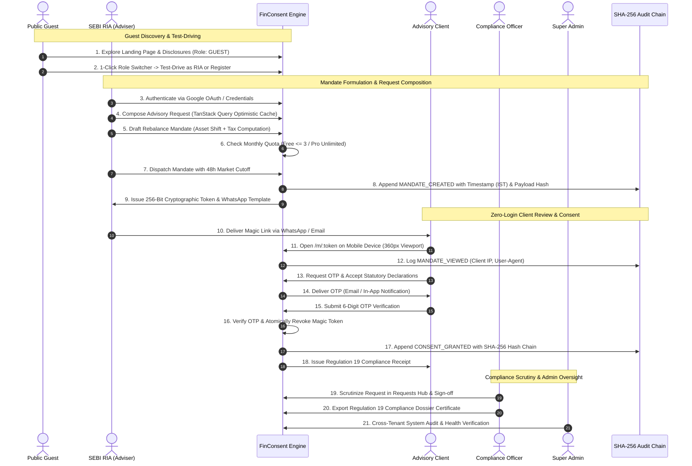

# FinConsent — End-to-End User Journey & Process Flow Architecture

This document defines the comprehensive user journeys, operational lifecycles, and statutory compliance workflows for **all 5 distinct roles** within the FinConsent platform:

1. **`guest`** — Public Visitor / Evaluator
2. **`ria`** — SEBI Registered Investment Adviser (Free & Pro Tiers)
3. **`compliance_officer`** — Compliance & Audit Officer / Regulatory Inspector
4. **`admin`** — Platform Super Administrator
5. **`client`** — Advisory Investor / Client (Zero-Login Magic Link & Authenticated Portal)

---

## 1. Role Taxonomy & Authorization Matrix

| Role ID | Role Title | Primary Interface | Authentication Mode | Core Capabilities & Permissions |
|---|---|---|---|---|
| **`guest`** | Public Visitor / Evaluator | Public Web Portal | Zero Login (Implicit Session) | • Explore statutory disclosures (SEBI, DPDP, Refund)<br>• Test-drive any persona via 1-click Role Switcher<br>• Access interactive role gates on protected routes<br>• Register RIA practice or sign in with credentials |
| **`ria`** | Registered Investment Adviser | Desktop Advisory Center | Email/Password or Google OAuth | • Draft trade rebalancing mandates (`/mandates/new`)<br>• Real-time Budget 2024 tax engine & Advance Tax alerts<br>• Compose advisory & compliance requests (`/requests`)<br>• Manage client roster (`/clients`) & billing quota<br>• Generate 256-bit magic links & WhatsApp dispatches<br>• Live lifecycle tracking & emergency link revocation<br>• Inspect Section 65B dossiers & audit records |
| **`compliance_officer`** | Compliance & Audit Officer | Statutory Audit Hub | Email/Password or Google OAuth | • Scrutinize & adjudicate advisory requests (`/requests`)<br>• Provide statutory response notes on rebalance items<br>• Audit mandate histories & client portfolios<br>• Verify SHA-256 immutable audit trail hash chaining<br>• Validate Section 65B electronic evidence admissibility<br>• Export signed SEBI Regulation 19 Compliance Dossiers |
| **`admin`** | Platform Super Admin | Operations Command Center | Email/Password or Google OAuth | • Universal cross-tenant visibility across all RIA practices<br>• User administration, quota overrides, & plan upgrades<br>• System-wide dispute resolution & audit logs review<br>• Monitor platform health & MongoDB Atlas sync state |
| **`client`** | Advisory Client / Investor | Mobile Smartphone (360px) & Client Web Portal | Zero-Login Magic Link (`/m/:token`) OR Authenticated Login | • Receive WhatsApp/Email notification with 48h cutoff<br>• Review asset allocation shift & trade execution basket<br>• Inspect pre-computed STCG/LTCG tax transparency<br>• Authorize trades via Mobile OTP verification<br>• Atomic token revocation upon successful consent<br>• Download tamper-evident Regulation 19 receipts<br>• Access personal request ledger when authenticated |

---

## 2. Global Multi-Party Interaction Architecture



---

## 3. Deep-Dive Process Flow: Role 1 — Guest Visitor (`guest`)

```
   ┌─────────────────────────────────────────────────────────────┐
   │                    GUEST PROCESS FLOW                       │
   └─────────────────────────────────────────────────────────────┘
                                │
                                ▼
   ┌─────────────────────────────────────────────────────────────┐
   │ 1. Public Discovery & Statutory Exploration                 │
   │    • Lands on platform (implicit role: 'guest')             │
   │    • Reviews SEBI IA Reg 2013 & DPDP Act 2023 Disclosures   │
   └─────────────────────────────────────────────────────────────┘
                                │
                                ▼
   ┌─────────────────────────────────────────────────────────────┐
   │ 2. Interactive Role Switcher in Navigation                  │
   │    • Navbar explicitly indicates "ROLE: GUEST"              │
   │    • Dropdown offers 1-click test drives across 5 personas  │
   └─────────────────────────────────────────────────────────────┘
                                │
                                ▼
   ┌─────────────────────────────────────────────────────────────┐
   │ 3. Protected Route Role-Gate Interception                   │
   │    • Guest attempts visiting /dashboard or /mandates/new    │
   │    • ProtectedRoute displays friendly Role Authentication   │
   │    • Options: 1-Click Test Drive as RIA / Sign In / Register│
   └─────────────────────────────────────────────────────────────┘
                                │
                                ▼
   ┌─────────────────────────────────────────────────────────────┐
   │ 4. Practice Registration or Google Authentication           │
   │    • Navigates to /register                                 │
   │    • Enters Principal Officer name, Firm Name, & Email      │
   │    • Validates SEBI Registration format: INAXXXXXXXXX       │
   │    • Submits form -> Auto-logged in with role: 'ria'        │
   └─────────────────────────────────────────────────────────────┘
```

### Detailed Steps:
1. **Implicit Guest Session Establishment:**
   - Any unauthenticated visitor is automatically assigned the `guest` role (`isGuest: true`, `user.name = "Guest Visitor"`).
   - `useAuth()` ensures no null-reference crashes; Navbar displays `ROLE: GUEST`.
2. **Statutory Disclosures Review:**
   - Accesses `/legal/privacy` (DPDP Act 2023 compliance, data retention in AWS Mumbai `ap-south-1`).
   - Accesses `/legal/terms` (SEBI non-discretionary mandate principles per Regulation 19).
   - Accesses `/legal/refund` (statutory subscription terms).
3. **Role-Gate Experience on Protected Routes:**
   - If a guest attempts to visit `/dashboard`, `/mandates/new`, or `/clients`, `ProtectedRoute.jsx` intercepts the transition and renders an interactive **Role Authentication Required** dialog.
   - The dialog displays permitted roles (e.g., `RIA`, `ADMIN`) and provides an immediate **"1-Click Test Drive as RIA"** button that automatically logs into a seeded test persona.
4. **RIA Firm Registration (`/register`):**
   - Guest fills out the registration form: Full Name, Advisory Firm Name, Work Email, Compliance Email, Password, and SEBI Registration Number.
   - Enforces regex validation: `^INA\d{9}$` (e.g., `INA000088921`).
   - Accepts statutory non-discretionary declaration checkbox.
   - On submission, backend creates account, generates JWT token, and redirects to `/dashboard`.

---

## 4. Deep-Dive Process Flow: Role 2 — SEBI Registered Investment Adviser (`ria`)

```
   ┌─────────────────────────────────────────────────────────────┐
   │                      RIA PROCESS FLOW                       │
   └─────────────────────────────────────────────────────────────┘
                                │
                                ▼
   ┌─────────────────────────────────────────────────────────────┐
   │ 1. Authentication & Profile Verification                    │
   │    • Sign in via Credentials or Google OAuth                │
   │    • Set INA number, firm branding, compliance contact      │
   └─────────────────────────────────────────────────────────────┘
                                │
                                ▼
   ┌─────────────────────────────────────────────────────────────┐
   │ 2. Client Roster Management (/clients)                      │
   │    • Add advisory clients (PAN, mobile, consideration)      │
   │    • TanStack Query caching & optimistic UI updates         │
   └─────────────────────────────────────────────────────────────┘
                                │
                                ▼
   ┌─────────────────────────────────────────────────────────────┐
   │ 3. Advisory Requests Hub (/requests)                        │
   │    • Compose rebalance proposals & asset allocation ratios  │
   │    • Set priorities: standard, high, urgent                 │
   └─────────────────────────────────────────────────────────────┘
                                │
                                ▼
   ┌─────────────────────────────────────────────────────────────┐
   │ 4. Rebalance Mandate Formulation (/mandates/new)            │
   │    • Select client & configure asset shift sliders          │
   │    • Budget 2024 Tax Engine: STCG 20%, LTCG 12.5%           │
   │    • Section 234B/234C Advance Tax quarterly alerts         │
   └─────────────────────────────────────────────────────────────┘
                                │
                                ▼
   ┌─────────────────────────────────────────────────────────────┐
   │ 5. Quota Verification & Magic Link Generation               │
   │    • Free plan: <= 3 active mandates; Pro: unlimited        │
   │    • Generate 256-bit cryptographically secure token        │
   │    • Dispatch via WhatsApp template or transactional email  │
   └─────────────────────────────────────────────────────────────┘
                                │
                                ▼
   ┌─────────────────────────────────────────────────────────────┐
   │ 6. Real-Time Mandate Monitoring & Audit Inspection          │
   │    • Track states: Draft -> Sent -> Viewed -> Consented     │
   │    • 48-Hour countdown badge; emergency link revocation     │
   │    • Download Section 65B Regulation 19 Compliance Dossier  │
   └─────────────────────────────────────────────────────────────┘
```

### Detailed Steps:
1. **Authentication:**
   - RIA logs in at `/login` using email/password or the unified Google OAuth button.
2. **Profile & SEBI Compliance Configuration (`/settings/profile`):**
   - Inputs official SEBI INA registration number and firm name.
   - Confirms territorial data residency badge (AWS Mumbai `ap-south-1`).
3. **Client Roster Management (`/clients`):**
   - Manages advisory clients with optimistic UI caching via TanStack Query.
   - Enforces PAN syntax (`[A-Z]{5}[0-9]{4}[A-Z]`) and 10-digit mobile number formatting.
4. **Advisory Requests Hub (`/requests`):**
   - Composes trade rebalance advisory requests with proposed asset ratios (Equity, Debt, Gold, Cash summing to 100%).
   - Selects priority (`standard`, `high`, `urgent`) and tracks live status (`pending`, `in_review`, `approved`, `completed`).
5. **Mandate Formulation & Real-Time Tax Calculations (`/mandates/new`):**
   - Selects target client and defines current vs. proposed asset allocation.
   - Real-time tax engine calculates:
     * Equity STCG @ 20% under Section 111A.
     * Equity LTCG @ 12.5% beyond ₹1,25,000 exemption under Section 112A.
     * 4% Health and Education Cess.
     * Section 234B/234C Advance Tax quarterly alerts if gain > ₹1,00,000.
   - Sets 48-hour market execution cutoff.
6. **Quota Check & Magic Link Generation:**
   - Free plan limits RIAs to 3 active mandates. If exceeded, displays Pro upgrade modal with Razorpay checkout (`/settings/billing`).
   - Generates a 256-bit cryptographic magic link (`/m/:token`).
   - Dispatches link via pre-formatted WhatsApp template or transactional email.
7. **Live Mandate Lifecycle Tracking & Emergency Controls (`/dashboard`):**
   - Monitors live lifecycle badge (`Draft`, `Sent`, `Viewed`, `Consented`, `Expired`).
   - Watches 48-hour countdown timer.
   - In case of market volatility, clicks **"Revoke Link"** to immediately invalidate the token.
   - Clicks **"Compliance Dossier"** to view and print the Regulation 19 certificate with SHA-256 hash chaining.

---

## 5. Deep-Dive Process Flow: Role 3 — Compliance & Audit Officer (`compliance_officer`)

```
   ┌─────────────────────────────────────────────────────────────┐
   │               COMPLIANCE OFFICER PROCESS FLOW               │
   └─────────────────────────────────────────────────────────────┘
                                │
                                ▼
   ┌─────────────────────────────────────────────────────────────┐
   │ 1. Auditor Authentication                                   │
   │    • Sign in with officer credentials                       │
   │    • Context switches to statutory scrutiny role            │
   └─────────────────────────────────────────────────────────────┘
                                │
                                ▼
   ┌─────────────────────────────────────────────────────────────┐
   │ 2. Advisory Requests Scrutiny (/requests)                   │
   │    • Filter requests by "Pending" or "In Review"            │
   │    • Inspect asset allocation shifts & advisory rationale   │
   │    • Submit formal approval/review with statutory notes     │
   └─────────────────────────────────────────────────────────────┘
                                │
                                ▼
   ┌─────────────────────────────────────────────────────────────┐
   │ 3. Client & Mandate Historical Registry Audit               │
   │    • Inspect all practice mandates and trade baskets        │
   │    • Verify client PAN masking and consent status           │
   └─────────────────────────────────────────────────────────────┘
                                │
                                ▼
   ┌─────────────────────────────────────────────────────────────┐
   │ 4. Tamper-Evident Audit Trail Analysis (/mandates/:id)       │
   │    • Verify chronological append-only audit timeline        │
   │    • Validate SHA-256 cryptographic hash chaining           │
   │    • Confirm Section 65B Electronic Evidence admissibility  │
   └─────────────────────────────────────────────────────────────┘
                                │
                                ▼
   ┌─────────────────────────────────────────────────────────────┐
   │ 5. Regulation 19 Compliance Dossier Certificate Export      │
   │    • Open Compliance Dossier Modal                          │
   │    • Validate Client PAN, IP address, User-Agent, & IST     │
   │    • Print or export official PDF certificate for SEBI bind │
   └─────────────────────────────────────────────────────────────┘
```

### Detailed Steps:
1. **Auditor Authentication:**
   - Logs in with compliance credentials (`compliance@example.in`) or via Role Switcher.
2. **Advisory Requests Scrutiny (`/requests`):**
   - Reviews requests submitted by advisers.
   - Enforces Regulation 19 risk profile tolerances.
   - Updates status to `approved`, `in_review`, or `rejected` with mandatory audit response notes.
3. **Audit Trail Verification (`/mandates/:id`):**
   - Reviews the immutable audit log: `MANDATE_CREATED` -> `MANDATE_DISPATCHED` -> `MANDATE_OPENED` -> `OTP_SENT` -> `CONSENT_GRANTED`.
   - Confirms SHA-256 hash chaining (`prevHash -> payloadHash`), guaranteeing that no records have been altered or deleted.
4. **Dossier Generation & Legal Certification:**
   - Opens **Compliance Dossier** modal.
   - Verifies the Indian Information Technology Act Section 65B Electronic Evidence statement.
   - Confirms AWS Mumbai territorial data residency.
   - Exports the digitally fingerprinted certificate for statutory filing.

---

## 6. Deep-Dive Process Flow: Role 4 — Platform Super Admin (`admin`)

```
   ┌─────────────────────────────────────────────────────────────┐
   │                 SUPER ADMIN PROCESS FLOW                    │
   └─────────────────────────────────────────────────────────────┘
                                │
                                ▼
   ┌─────────────────────────────────────────────────────────────┐
   │ 1. Administrative Authentication                            │
   │    • Sign in with superuser credentials                     │
   │    • Unconstrained RBAC access across all endpoints         │
   └─────────────────────────────────────────────────────────────┘
                                │
                                ▼
   ┌─────────────────────────────────────────────────────────────┐
   │ 2. Cross-Tenant System Observability                        │
   │    • View all mandates, requests, and clients across RIAs   │
   │    • Track platform-wide volume, active plans, and usage    │
   └─────────────────────────────────────────────────────────────┘
                                │
                                ▼
   ┌─────────────────────────────────────────────────────────────┐
   │ 3. User Governance & Quota Overrides                        │
   │    • Manage adviser accounts, plans (Free -> Pro), and quota│
   │    • Resolve user role disputes or configuration errors     │
   └─────────────────────────────────────────────────────────────┘
                                │
                                ▼
   ┌─────────────────────────────────────────────────────────────┐
   │ 4. Dispute Resolution & Override Adjudication               │
   │    • Resolve blocked mandates or emergency escalations      │
   │    • Full write & update permissions on requests & mandates │
   └─────────────────────────────────────────────────────────────┘
                                │
                                ▼
   ┌─────────────────────────────────────────────────────────────┐
   │ 5. Infrastructure & Compliance Health Monitoring            │
   │    • Verify /api/health endpoint status                     │
   │    • Inspect MongoDB Atlas (AWS Mumbai) synchronization     │
   │    • Validate SMS deprecation policy adherence              │
   └─────────────────────────────────────────────────────────────┘
```

### Detailed Steps:
1. **Superuser Entry:**
   - Authenticates as Platform Admin (`admin@example.in`).
   - Receives unconstrained access across all routes and API actions.
2. **Cross-Tenant Oversight:**
   - Oversees all RIA advisory practices, mandates, and client interactions.
   - Inspects live database statistics (1,000+ users, 200+ clients, 350+ mandates).
3. **Plan Governance & Quota Overrides:**
   - Upgrades RIA accounts from Free to Pro.
   - Overrides monthly mandate limits during peak market rebalancing windows.
4. **Infrastructure & Compliance Verification:**
   - Monitors `/api/health` to ensure live database connectivity, Google OAuth readiness, and adherence to the SMS-disabled policy.

---

## 7. Deep-Dive Process Flow: Role 5 — Advisory Client / Investor (`client`)

Clients can interact through two distinct pathways: **Path A (Zero-Login Magic Link)** and **Path B (Authenticated Portal)**.

### Path A: Zero-Login Cryptographic Magic Link (`/m/:token`) — Primary Client Experience

```
   ┌─────────────────────────────────────────────────────────────┐
   │              CLIENT PATH A (ZERO-LOGIN MAGIC LINK)          │
   └─────────────────────────────────────────────────────────────┘
                                │
                                ▼
   ┌─────────────────────────────────────────────────────────────┐
   │ 1. Notification Reception                                   │
   │    • Receives WhatsApp or Email with 48-hour cutoff notice  │
   │    • Taps 256-bit magic link (e.g. /m/a9f48...)             │
   └─────────────────────────────────────────────────────────────┘
                                │
                                ▼
   ┌─────────────────────────────────────────────────────────────┐
   │ 2. Mobile Review (360px Viewport, <1.2s Load)               │
   │    • Zero login required                                    │
   │    • Displays RIA firm name, SEBI INA number, masked PAN    │
   │    • Compares Current vs. Proposed Asset Allocation         │
   │    • Inspects trade sell baskets with sale values           │
   │    • Reviews pre-computed STCG 20% & LTCG 12.5% tax impact │
   │    • Advance Tax quarterly alert banner if gain > ₹1 Lakh   │
   └─────────────────────────────────────────────────────────────┘
                                │
                                ▼
   ┌─────────────────────────────────────────────────────────────┐
   │ 3. Statutory Consent & Mobile OTP Verification              │
   │    • Taps "Authorize Rebalance with Mobile OTP"             │
   │    • Accepts mandatory SEBI Regulation 19 declarations      │
   │    • Requests 6-digit OTP (delivered via email/in-app)      │
   │    • Enters 6-digit code with 5-minute countdown            │
   └─────────────────────────────────────────────────────────────┘
                                │
                                ▼
   ┌─────────────────────────────────────────────────────────────┐
   │ 4. Atomic Revocation & Tamper-Proof Compliance Receipt      │
   │    • Backend verifies OTP and IMMEDIATELY revokes token     │
   │    • Prevents replay attacks or double-consents             │
   │    • Redirects to /m/:token/receipt                         │
   │    • Displays SHA-256 fingerprint & Section 65B receipt     │
   │    • Download or print receipt for personal records         │
   └─────────────────────────────────────────────────────────────┘
```

### Path B: Authenticated Client Portal (`/dashboard`, `/requests`)

1. **Authentication:** Client signs in at `/login` using registered credentials or Google OAuth.
2. **Dashboard Overview:** Views personal rebalancing history, active proposals, and consented mandates.
3. **Advisory Requests Participation (`/requests`):** Inspects requests initiated by their adviser and tracks compliance approval status.
4. **Historical Receipts Access:** Accesses historical Section 65B compliance certificates for past rebalance transactions.

---

## 8. Mandate Lifecycle State Machine

```
               ┌────────────────────────────────────────────────────────┐
               │                                                        │
               ▼                                                        │
          ┌─────────┐       RIA Dispatches Link      ┌──────────┐       │
          │  DRAFT  │ ─────────────────────────────> │   SENT   │       │
          └─────────┘                                └──────────┘       │
               │                                          │             │
               │                                          │ Client      │ Emergency
               │                                          │ Opens Link  │ Revoke
               │                                          ▼             │
               │                                     ┌──────────┐       │
               │                                     │  VIEWED  │ ──────┘
               │                                     └──────────┘
               │                                          │
               │                                          │ OTP Verified &
               │ 48-Hour                                  │ Declarations Accepted
               │ Cutoff                                   ▼
               │ Elapsed                             ┌───────────┐
               └───────────────────────────────────> │ CONSENTED │ (Token Revoked, Locked)
                                                     └───────────┘
                                                          │
                                                          ▼
                                                     ┌───────────┐
                                                     │  EXPIRED  │ (Lapsed without Consent)
                                                     └───────────┘
```

---

## 9. Comprehensive Edge Cases & Resilience Patterns

| Edge Case | Involved Role | User Experience | System Handling & Defense |
|---|---|---|---|
| **Free Plan Quota Exceeded (4th Mandate)** | `ria` | In-app dialog modal explaining 3-mandate monthly quota. | Intercepted at API level (`403 Forbidden` with `quotaExceeded: true`); provides 1-click Razorpay checkout and WhatsApp concierge. |
| **Market Volatility Pre-Consent** | `ria` | RIA clicks "Revoke Link" on dashboard. | Magic token set to `null` and marked `isRevoked: true`; audit entry `LINK_REVOKED` logged; client viewing link receives `410 Expired`. |
| **Client Opens Expired Link (>48h)** | `client` | Red statutory warning indicating cutoff window has lapsed. | Server returns `410 Gone`; blocks OTP requests; instructs client to contact adviser for revised terms. |
| **Tampered / Invalid Magic Token URL** | `guest`, `client` | Client sees clean error screen indicating link not found. | Server rejects invalid token; returns zero PII or financial data. |
| **Link Re-use Post-Consent** | `client` | Client or third party opens magic link again after authorization. | Server returns `410 Gone` because token was atomically deleted upon OTP verification; prevents double-consent. |
| **Guest Attempts Privileged Route** | `guest` | Interactive Role-Gate dialog modal displayed on screen. | `ProtectedRoute.jsx` intercepts navigation; offers 1-click test drive as permitted role or redirect to login. |
| **Role Restriction Breach (e.g. Client creating Mandate)** | `client` | Screen displays "Access Restricted by Role (RBAC)". | Server enforces `requireRole(['ria', 'admin'])` and returns `403 Forbidden`. |
| **SMS Service Outage / Deprecation** | `client` | OTP received via registered email / in-app notification. | SMS completely deprecated by architectural policy; transactional emails handle OTP delivery reliably. |
