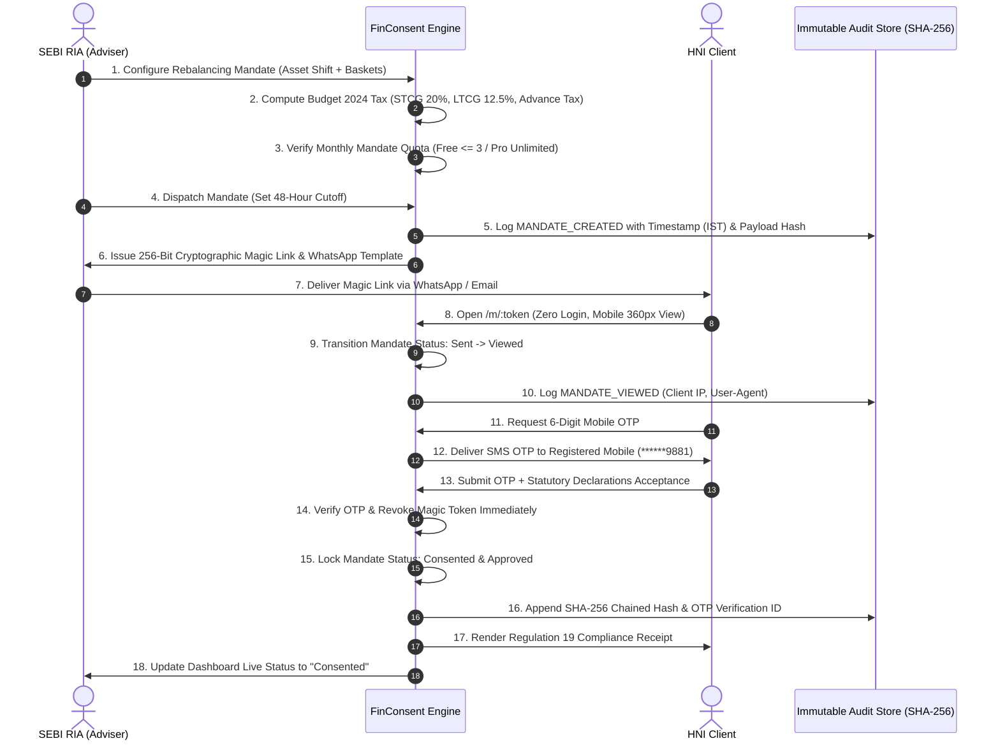

# FinConsent — End-to-End User Journey Specifications

This document defines the comprehensive user journeys, interaction lifecycles, and state transitions for each persona interacting with the FinConsent statutory trade authorization platform.

---

## 1. Persona Overview

| Role ID | Persona Name | Primary Context | Core Motivation | Device & Channel |
|---|---|---|---|---|
| **`sebi-ria`** | SEBI Registered Investment Adviser | Wealth advisory office / desktop | Deliver fiduciary advice, eliminate execution slippage, ensure 100% audit-proof compliance under SEBI Regulation 19. | Desktop / Laptop (Chrome, Edge) |
| **`hni-client`** | High-Net-Worth Advisory Client | Mobile smartphone / on-the-go | Quickly understand asset shifts and capital gains tax impact without legalistic jargon, authorize trade in <60 seconds without login. | Mobile Smartphone (iOS Safari, Android Chrome, WhatsApp) |
| **`compliance-auditor`** | Compliance Officer / SEBI Auditor | Compliance inspection / audit | Verify chain-of-custody, Section 65B electronic evidence, SHA-256 tamper-evidence, and AWS Mumbai data residency. | Desktop Web Portal / PDF Export |

---

## 2. High-Level Architectural Flow Diagram



---

## 3. Detailed Journey Walkthrough: SEBI Registered Investment Adviser (`sebi-ria`)

### Step 1: Authentication & Workspace Setup
1. **Access Portal:** RIA visits `/auth` and logs in using registered email/password (bcrypt hashed) or Google OAuth.
2. **SEBI Profile Verification:** 
   - Navigates to `/settings/profile`.
   - Inputs official SEBI Registration Number (format: `INAXXXXXXXXXX`, e.g., `INA000019284`).
   - Configures RIA firm brand name (e.g., *Shikhar Capital Advisors*) and compliance officer email.
   - Confirms AWS Mumbai (`ap-south-1`) data residency status badge.

### Step 2: Client Management
1. **Directory Inspection:** Visits `/clients` to view active non-discretionary advisory mandates.
2. **Client Onboarding:** 
   - Clicks **"Add New Advisory Client"**.
   - Enters client legal name (*Vikram Joshi*), PAN (*ABCDE1234F*), mobile (*+91 98201 99881*), email, and estimated portfolio consideration (*₹75,00,000*).
   - Validates Indian PAN structure and 10-digit mobile number.

### Step 3: Rebalance Mandate Formulation
1. **Initiate Mandate:** From Dashboard (`/dashboard`), clicks **"Draft Rebalance Mandate"** (`/mandates/new`).
2. **Select Target Client:** Selects client profile from pre-populated dropdown.
3. **Asset Allocation Shift:** 
   - Specifies current allocation sliders (e.g., Equity 75%, Debt 15%, Gold 5%, Cash 5%).
   - Adjusts proposed target allocation (e.g., Equity 60%, Debt 25%, Gold 10%, Cash 5%).
4. **Trade Basket Configuration:** 
   - Defines sell basket securities with unit quantities, execution prices, and holding classification (STCG vs. LTCG).
5. **Real-Time Tax Computation:** 
   - Live tax engine computes:
     * Equity STCG @ 20% under Section 111A.
     * Equity LTCG @ 12.5% beyond ₹1,25,000 statutory exemption under Section 112A.
     * 4% Health and Education Cess.
     * Section 234B/234C Advance Tax quarterly deadline alert (15 June, 15 September, 15 December, or 15 March) if gross gain > ₹1,00,000.
6. **Set Cutoff Expiration:** Specifies market execution cutoff (defaults to 48 hours to prevent execution slippage).

### Step 4: Quota Check & Pro Upgrade Prompt (Free-Tier Edge Case)
1. **Quota Evaluation:** 
   - If RIA is on Free Tier and has published 3 mandates within the current calendar month, the system intercepts the creation.
2. **In-App Error Modal:**
   - Displays **"Free Tier Monthly Mandate Quota Exceeded"** modal.
   - Explains statutory record-keeping constraints.
   - Offers two immediate paths:
     * **"Upgrade with Razorpay"**: Navigates to `/billing` to trigger Pro plan checkout (₹4,999/yr + GST).
     * **"Upgrade via WhatsApp"**: Launches pre-filled WhatsApp concierge message.

### Step 5: Magic Link Generation & Multi-Channel Dispatch
1. **Dispatch Mandate:** RIA clicks **"Create & Generate Magic Link"**.
2. **Cryptographic Link Creation:** 
   - System generates a 256-bit cryptographically secure pseudorandom token (`crypto.randomBytes(32).toString('hex')`).
   - Associates token with 48-hour expiration timestamp.
3. **Dispatch Modal Options:**
   - **One-Click Link Copy:** Copies `https://finconsent.in/m/{token}` to clipboard.
   - **Direct WhatsApp Dispatch:** Generates formatted WhatsApp URI with advisory summary, estimated tax liability in ₹ Lakhs, and 48-hour expiry notice.
   - **Transactional Email Dispatch:** Triggers Resend transactional email notification to client.

### Step 6: Live Mandate Control & Auditing
1. **Dashboard Monitoring:** 
   - Monitors mandate status in real-time across 5 lifecycle stages:
     * **`Draft`**: Advisory proposal prepared, not yet dispatched.
     * **`Sent`**: Magic link issued and delivered to client.
     * **`Viewed`**: Client opened proposal on mobile device.
     * **`Consented`**: Client successfully completed Mobile OTP verification.
     * **`Expired`**: 48-hour window lapsed without consent.
2. **Expiration Countdown:** 
   - Live badge shows remaining time (e.g., `47h 12m left (48h window)`).
3. **Emergency Revocation:** RIA can click **"Revoke Link"** to immediately invalidate the token and stop client authorization if market volatility changes execution terms.
4. **Dossier Download:** Once consented, RIA clicks **"Dossier"** to review the SEBI Regulation 19 Compliance Certificate with timestamp (IST), client IP, User-Agent, and SHA-256 integrity hash.

---

## 4. Detailed Journey Walkthrough: High-Net-Worth Advisory Client (`hni-client`)

### Step 1: Receiving the Mandate Notification
1. **Channel Delivery:** Client receives a WhatsApp message or SMS from their adviser:
   > *"Namaste Vikram, your SEBI RIA Shikhar Capital Advisors has prepared your Q3 Portfolio Rebalancing Mandate with ₹1,07,250 pre-computed tax impact. Review and authorize within 48 hours: https://finconsent.in/m/a9f48... (No login required)"*
2. **One-Tap Access:** Client taps the link on their smartphone (iOS Safari / Android Chrome).

### Step 2: Zero-Login Mobile Inspection (360px Viewport)
1. **Instant Loading:** Proposal loads in <1.2 seconds over 4G mobile connection with zero login friction.
2. **RIA Credential Header:** Displays adviser's firm name, logo, and SEBI Registration Number (`INA000019284`) alongside client masked PAN (`AB*****4F`).
3. **Visual Asset Reallocation Comparison:**
   - Progress bar comparisons show current allocation (75% Equity / 15% Debt) vs. proposed allocation (60% Equity / 25% Debt).
4. **Trade Execution Basket:**
   - Clearly lists securities to sell, number of units, and sale consideration in Indian numbering format (`₹12,50,000`).
5. **Tax Transparency Banner:**
   - Highlights estimated capital gains tax breakdown (STCG 20%, LTCG 12.5%).
   - If net gain > ₹1,00,000, displays **Advance Tax Alert Banner** reminding client to account for the tax liability before the upcoming quarterly installment deadline (preventing penal interest under Section 234B/234C).

### Step 3: Statutory Acceptance & Mobile OTP Verification
1. **Initiate Sign-off:** Client taps **"Authorize Rebalance with Mobile OTP"** (touch target >= 48px).
2. **Statutory Consent Declaration:**
   - Modal presents mandatory checkboxes:
     * Informed consent under Regulation 19 of SEBI (Investment Advisers) Regulations, 2013.
     * Acknowledgment of estimated capital gains tax obligation.
3. **OTP Dispatch:** Client clicks **"Request 6-Digit OTP"**.
   - FinConsent dispatches 6-digit cryptographic OTP to registered mobile (`******9881`).
   - Modal displays 5-minute countdown timer and masked phone indicator.
4. **Submit Authorization:** 
   - Client enters 6-digit code.
   - Client clicks **"Confirm & Grant Trade Consent"**.

### Step 4: Token Revocation & Compliance Receipt
1. **Immediate Revocation:** The 256-bit magic link token is immediately revoked in the database upon submission. Any subsequent attempt to open the link renders a secure "Mandate Link Revoked / Already Consented" screen.
2. **Instant Receipt Page (`/m/:token/receipt`):**
   - Displays green verification seal: **"Trade Consent Successfully Granted"**.
   - Displays **SEBI Regulation 19 Statutory Receipt ID** and cryptographic SHA-256 hash.
   - Confirms statutory 5-year retention in AWS Mumbai (`ap-south-1`).
   - Provides **"Print / Download Compliance Receipt"** button.

---

## 5. Detailed Journey Walkthrough: Compliance Officer / SEBI Auditor (`compliance-auditor`)

### Step 1: Inspection Initiation
1. **Auditor Context:** During an inspection under SEBI (Investment Advisers) Regulations, 2013, the compliance team or visiting SEBI inspection officer requires proof of prior informed consent for non-discretionary trades executed in FY 2026-27.
2. **Accessing Audit Records:** Compliance officer navigates to `/mandates/:id` in the FinConsent workspace.

### Step 2: Audit Trail Verification
1. **Timeline Inspection:** 
   - Inspects the chronological, append-only audit trail (`AuditTrailTimeline.jsx`).
   - Verifies each immutable event record:
     * `MANDATE_CREATED`: Proposal drafted with specific trade values and tax calculations.
     * `MANDATE_DISPATCHED`: 256-bit magic token generated with 48-hour expiration.
     * `MANDATE_OPENED`: Timestamp (IST), client IP address, and client User-Agent recorded upon magic link view.
     * `OTP_SENT`: SMS dispatch record with masked mobile destination.
     * `CONSENT_GRANTED`: Verification timestamp (IST), client OTP verification ID, declarations accepted, and cryptographic SHA-256 payload hash.
2. **Hash Chaining Validation:**
   - Confirms that each audit log entry is linked to the previous entry via SHA-256 cryptographic hashing (`prevHash -> payloadHash`), preventing retroactive manipulation or deletion of historical records.

### Step 3: SEBI Regulation 19 Dossier Export
1. **Generate Certificate:** Clicks **"Compliance Dossier"** (`ComplianceDossierModal.jsx`).
2. **Examine Statutory Certificate:**
   - Header: *SEBI Regulation 19 Trade Consent Certificate*.
   - Section 65B Electronic Evidence statement (under Indian Information Technology Act, 2000).
   - Full mandate trade breakdown and tax obligation schedule.
   - Verification metadata: Client PAN, Mobile, IP Address, Browser User-Agent, and exact IST timestamp.
   - SHA-256 Certificate Fingerprint.
   - AWS Mumbai (`ap-south-1`) territorial data residency certification.
3. **Export:** Prints or saves clean PDF for submission to the SEBI inspection binder.

---

## 6. Lifecycle State Machine

```
              ┌──────────────────────────────────────────────┐
              │                                              │
              ▼                                              │
         ┌─────────┐   RIA Dispatches Link    ┌──────────┐   │
         │  DRAFT  │ ───────────────────────> │   SENT   │   │
         └─────────┘                          └──────────┘   │
              │                                    │         │
              │                                    │ Client  │ Revoke &
              │                                    │ Opens   │ Regenerate
              │                                    ▼ Link    │
              │                               ┌──────────┐   │
              │                               │  VIEWED  │ ──┘
              │                               └──────────┘
              │                                    │
              │                                    │ OTP Verified &
              │ 48 Hours                           │ Declarations Accepted
              │ Elapsed                            ▼
              │                               ┌───────────┐
              └─────────────────────────────> │ CONSENTED │ (Token Revoked, Locked)
                                              └───────────┘
                                                   │
                                                   ▼
                                              ┌───────────┐
                                              │  EXPIRED  │ (Lapsed before OTP)
                                              └───────────┘
```

---

## 7. Edge Cases & Resilience Patterns

| Edge Case | User Experience | System Handling |
|---|---|---|
| **Free-Tier 4th Mandate Attempt** | RIA receives in-app Dialog modal explaining monthly quota limit. | Blocked at API level (`403 Forbidden` with `quotaExceeded: true`); WhatsApp & Razorpay checkout buttons provided. |
| **Market Volatility Pre-Consent** | RIA clicks "Revoke Link" on dashboard. | Magic token set to `null` and flagged `isRevoked: true`; audit entry `LINK_REVOKED` appended; client viewing link sees 410 Expired message. |
| **Client Opens Expired Link (>48h)** | Client sees red statutory shield warning indicating proposal cutoff window has lapsed. | Server returns `410 Gone`; blocks OTP requests; instructs client to contact RIA for updated rebalancing mandate. |
| **Tampered Magic Token URL** | Client sees `404 Not Found` error. | Server rejects invalid 256-bit token; returns zero financial or PII data. |
| **Multiple OTP Retries** | Client receives error "Invalid 6-digit OTP". | OTP expires after 300 seconds; brute-force protection rejects invalid entries. |
| **Immediate Link Re-use Post-Consent** | Client or third party clicks magic link again after authorization. | Server immediately returns 404/410 because token was deleted upon consent verification; prevents double-authorization. |
